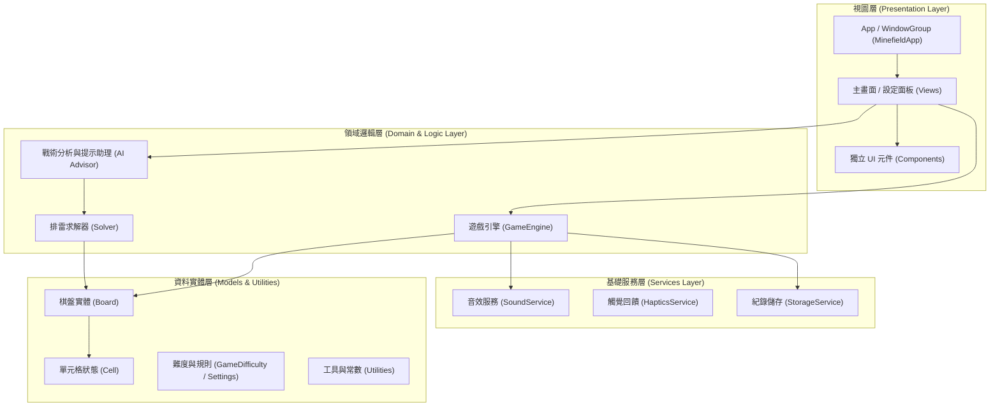

# Minefield 架構設計文件 (Architecture Specification)

## 一、系統概述

**Minefield** 是一款專為 Apple Silicon Mac 打造的原生 macOS 現代掃雷遊戲，採用 Swift 6、SwiftUI 與 Apple 原生框架建構，以極致效能、流暢動畫、嚴格的 macOS 人機介面指南 (HIG) 以及先進的演算法為核心特色。

### 基本規格
- **應用程式名稱**：Minefield
- **Bundle Identifier**：`com.minefield.macos`
- **主要語言**：繁體中文 (Traditional Chinese)
- **最低系統需求**：macOS 14.0 (Sonoma) 或更新版本
- **硬體架構**：Apple Silicon (ARM64 原生)
- **核心框架**：SwiftUI, AppKit (選單與視窗深度整合), Combine, XCTest, UniformTypeIdentifiers

---

## 二、分層架構設計

專案採用清晰的關注點分離 (Separation of Concerns)，嚴格劃分資料、狀態管理、運算引擎與渲染層：

### 1. 模組分工詳解

| 目錄 / 模組 | 職責說明 |
|---|---|
| `Sources/Minefield/App` | 應用程式進入點、主視窗生命週期、系統選單列 (Menu Bar Commands)、熱鍵綁定。 |
| `Sources/Minefield/Views` | 主遊戲視窗、頂部控制列、結算面板、歷史戰績統計視圖、自訂難度彈出視窗。 |
| `Sources/Minefield/Components` | 棋盤網格 (`BoardGridView`)、單元格互動按鈕、LED 風格計時器/計雷器、表情反饋按鈕。 |
| `Sources/Minefield/GameEngine` | 核心掃雷狀態機、無死角首發保證 (Safe First Click)、洪水填充展開演算法 (Flood Fill)、勝利/失敗檢測。 |
| `Sources/Minefield/Solver` | 命題邏輯約束滿足求解器 (CSP)、貝氏機率排雷推導、死局 (50/50 猜測) 識別演算法。 |
| `Sources/Minefield/AI` | 智能提示產生器、盤面局勢分析、解說步驟引導與戰術學習助理。 |
| `Sources/Minefield/Services` | 原生音效播放 (AVFoundation/AudioToolbox)、觸覺反饋、本機分數紀錄與排行榜持久化。 |
| `Sources/Minefield/Settings` | 使用者偏好設定管理 (音效、旗幟標記模式、視覺主題、快捷鍵自訂)。 |
| `Sources/Minefield/Models` | 不可變資料結構：`Board`、`Cell`、`GameDifficulty`、`GameState`、`GameRecord`。 |
| `Sources/Minefield/Utilities` | 數學運算、幾何座標輔助、常數定義、日誌記錄器。 |

---

## 三、建置與交付管線

本專案完全基於 macOS 原生命令列工具鏈，不依賴任何第三方套件管理工具或外部遊戲引擎。

### 自動化腳本清單
1. **`Scripts/bootstrap.sh`**：自動檢查目前 Apple Silicon 架構、macOS SDK、Swift 編譯器、系統打包工具（`hdiutil`, `codesign`, `iconutil`, `sips`）。
2. **`Scripts/test.sh`**：並行執行完整 XCTest 單元測試套件，確保程式邏輯無迴歸。
3. **`Scripts/build.sh`**：編譯 Release 最佳化二進位檔案，組裝標準 macOS `.app` 目錄結構，產出 `Info.plist` 與 `AppIcon`，並完成程式碼簽章。
4. **`Scripts/package-dmg.sh`**：產生支援拖曳安裝至 `/Applications` 的標準 UDZO 壓縮磁碟映像檔 (`Minefield-AppleSilicon.dmg`)。

---

## 四、未來階段演進計畫

- **Phase 2**：核心遊戲引擎 (Game Engine)、自訂難度、無猜測生成模式、洪水連鎖翻開演算法。
- **Phase 3**：現代 SwiftUI 互動介面、Metal 粒子特效、LED 計時器、音效與觸覺震動。
- **Phase 4**：機率求解器 (CSP Solver) 與 AI 即時提示助理。
- **Phase 5**：統計排行榜、自訂佈景主題、深色/淺色模式自適應。
- **Phase 6**：完整端對端自動化測試、DMG 美化包裝與最終發佈驗證。
